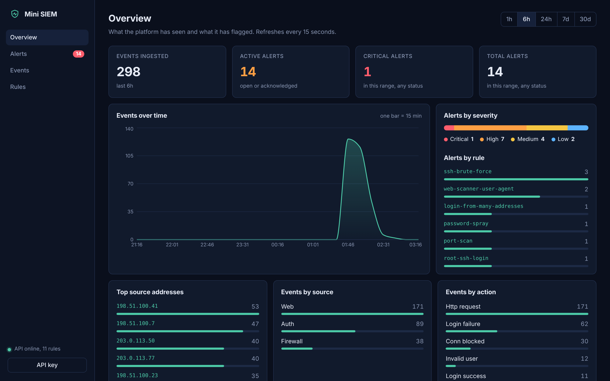
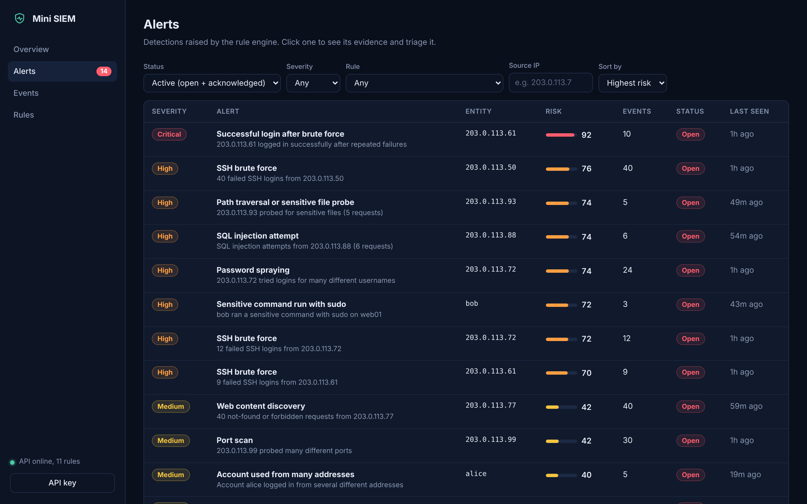
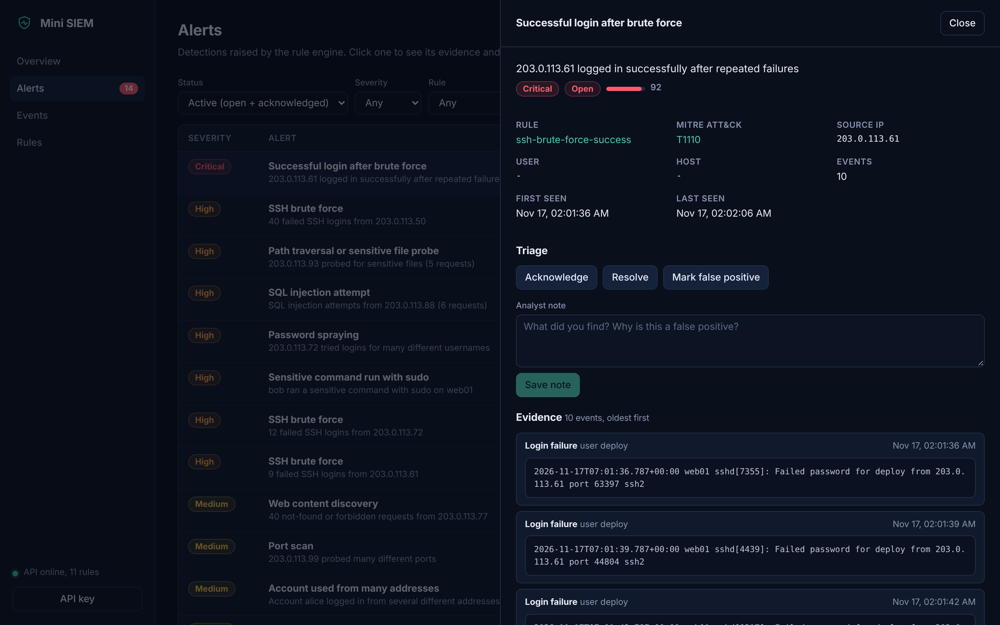
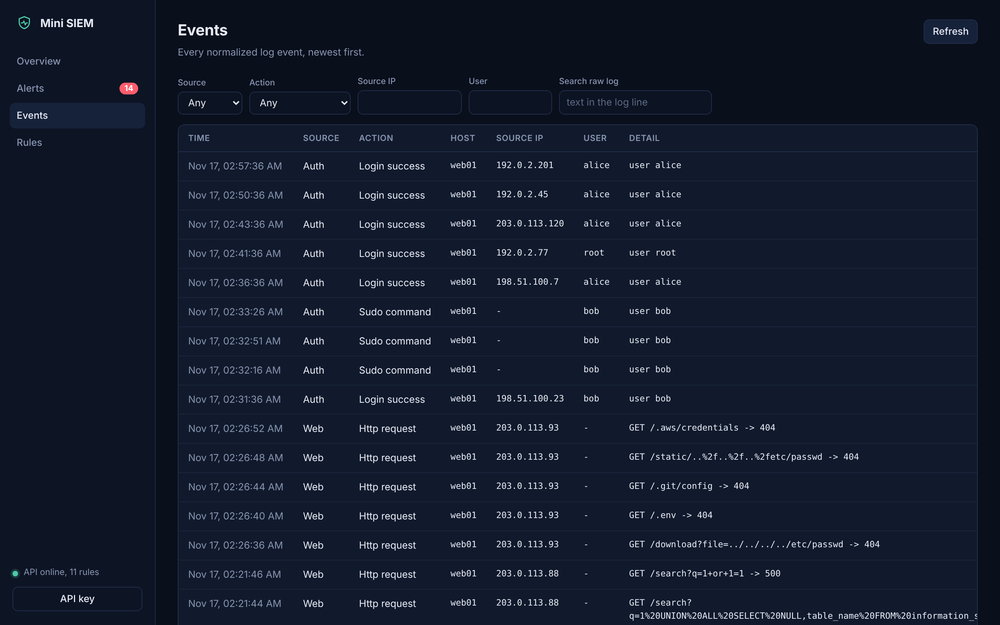
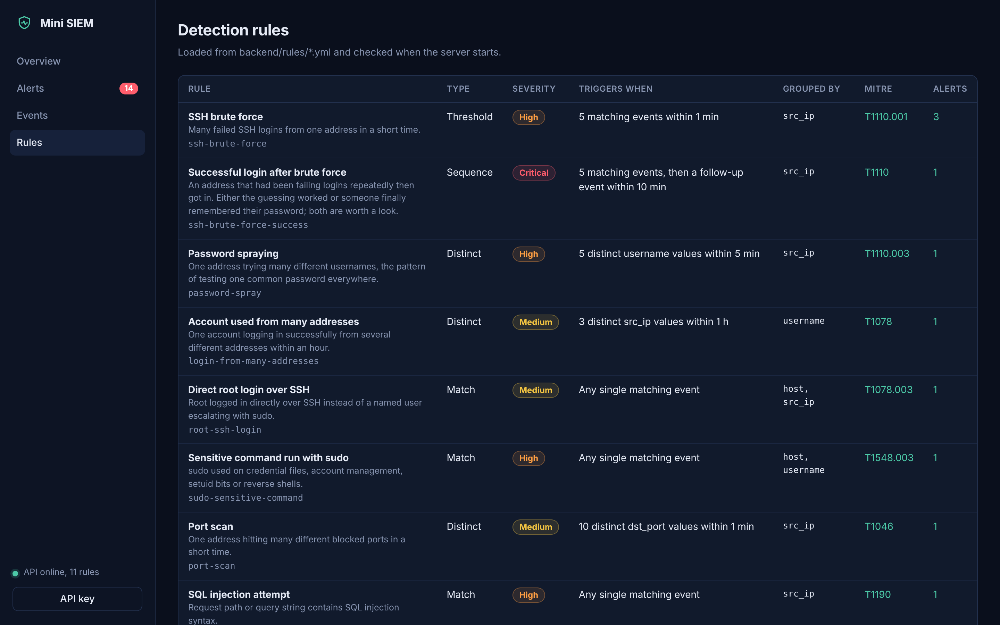
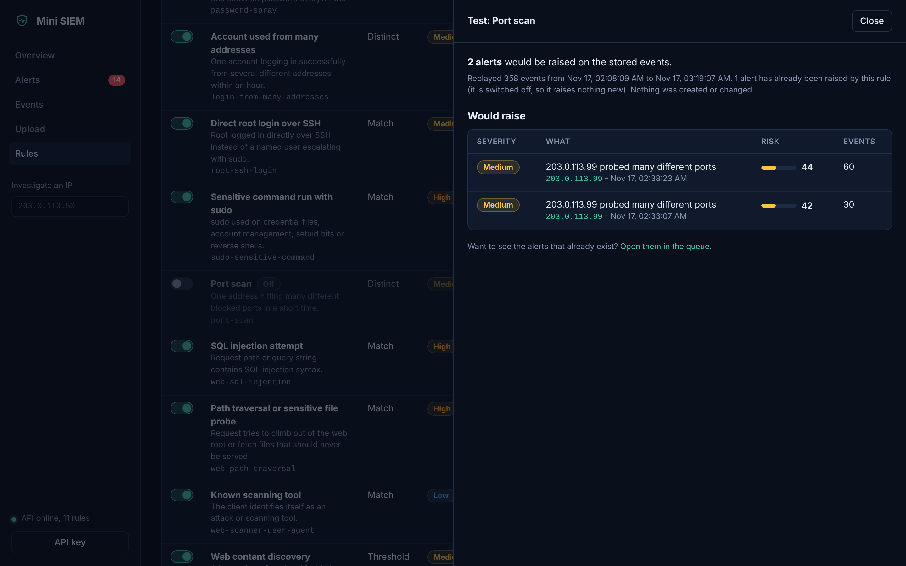
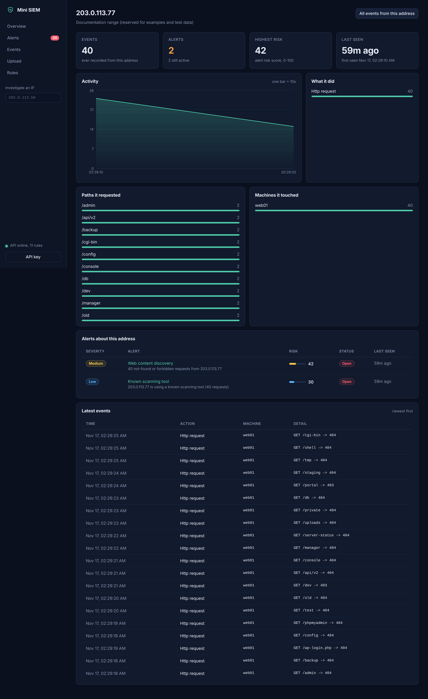
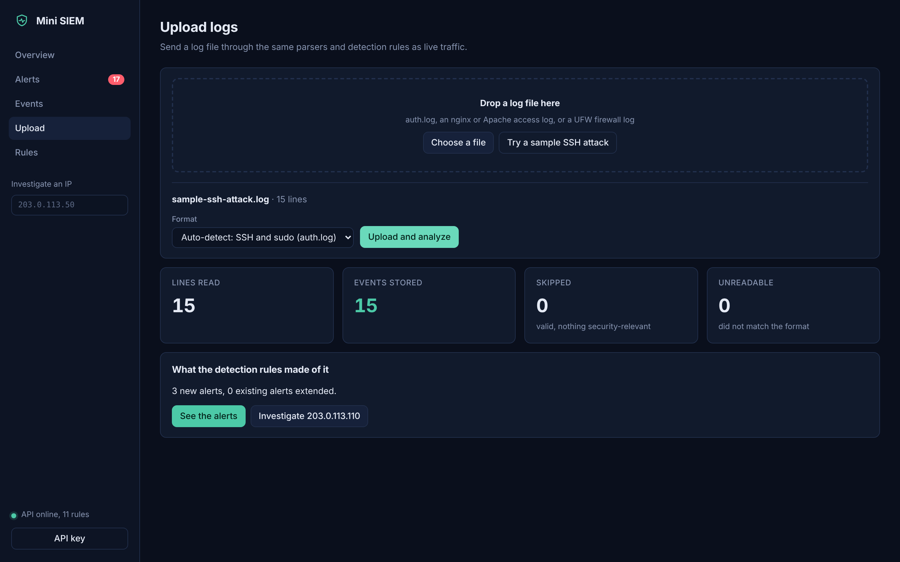
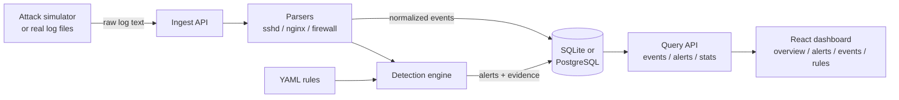

# Mini SIEM

A small security information and event management (SIEM) platform. It ingests raw security
logs, normalizes them into one event schema, runs detection rules over them, and raises
deduplicated, severity-scored alerts with the evidence attached.

Status: complete. A tested FastAPI backend and a React dashboard on top of it.



<details>
<summary>More screenshots</summary>









</details>

## What it does

- **Ingests three log formats** as raw text: SSH/sudo (`auth.log`), nginx/Apache access logs,
  and UFW firewall logs. Pre-structured JSON events are accepted too.
- **Normalizes** every line into a common event (who, from where, did what, when), so one rule
  language works across all sources.
- **Detects attacks** with 11 YAML rules of four kinds: signature match, threshold, distinct
  count, and sequence. Each rule is tagged with its MITRE ATT&CK technique.
- **Raises alerts** that group an ongoing attack into one alert instead of hundreds, carry a
  0-100 risk score, link to the exact events that triggered them, and move through a triage
  workflow (open, acknowledged, resolved, false positive).
- **Shows it in a dashboard**: an overview with an event timeline and top attackers, a filterable
  alert queue with an evidence drawer and triage controls, a searchable event log, and the rule list.
- **Simulates attacks** so there is always something to detect: 11 scenarios generate
  realistic log traffic and send it through the full pipeline.



## Quick start

### Without Docker (SQLite)

Needs Python 3.11 or newer.

```bash
cd backend
python3 -m venv .venv && source .venv/bin/activate
pip install -r requirements.txt
uvicorn app.main:app --reload
```

The API is at <http://localhost:8000> and interactive docs at <http://localhost:8000/docs>.
Data goes to `backend/minisiem.db`; delete that file to start over.

### With Docker (PostgreSQL)

```bash
docker compose up --build
```

The dashboard is at <http://localhost:8080> and the API at <http://localhost:8000>.

### See it detect something

In a second terminal, from the repository root:

```bash
python3 simulator/simulate.py
```

```text
brute_force            sshd        40 events stored, 1 new alerts, 0 updated
brute_force_success    sshd        10 events stored, 2 new alerts, 0 updated
port_scan              firewall    30 events stored, 1 new alerts, 0 updated
...
Done: 298 events, 14 alerts raised.
```

Then look at what was raised, highest risk first:

```bash
curl "http://localhost:8000/api/v1/alerts?sort=score"
```

`python3 simulator/simulate.py --list` shows every scenario, and `-s brute_force port_scan`
runs only the ones you name. You can also send a real log file:

```bash
curl -X POST --data-binary @samples/auth.log -H "Content-Type: text/plain" \
     http://localhost:8000/api/v1/ingest/sshd
```

## Dashboard

The dashboard lives in `frontend/` (React, TypeScript, Vite). With the backend running on port 8000:

```bash
cd frontend
npm install
npm run dev
```

Open <http://localhost:5173>. Vite forwards `/api` to the backend, so there is nothing to configure; set
`VITE_BACKEND_URL` if the backend is not on `localhost:8000`. If you set `MINISIEM_API_KEY`, enter the
same value under **API key** in the sidebar.

| Page | What it is for |
| --- | --- |
| Overview | Event and alert counts, an event timeline, alerts by severity and rule, top source addresses, and the highest-risk active alerts. Pick a time range from 1 hour to 30 days; it refreshes every 15 seconds. |
| Alerts | The triage queue. Filter by status, severity, rule and source address. Click an alert to see its evidence (the raw log lines that triggered it), acknowledge, resolve or mark it a false positive, and leave a note. **Export CSV** downloads whatever the filters currently show. |
| Events | Search every normalized event by source, action, address, user or text in the raw line. Click a row to see the original log line. **Export CSV** downloads the matching events. |
| Investigate (`/ips/<address>`) | Everything known about one address: what kind of address it is (public, private, documentation range...), activity over time, the accounts, ports and URL paths it touched, every alert about it and its latest events. Reached by clicking any address, or from the **Investigate an IP** box in the sidebar. |
| Upload | Drop in an auth.log, an nginx or Apache access log, or a UFW log. The format is detected, the file goes through the same parsers and rules as live traffic, and you see how many events were stored and which alerts were raised. "Try a sample SSH attack" generates a brute force you can investigate straight away. |
| Rules | Each loaded rule in plain language, its MITRE ATT&CK technique, and how many alerts it has raised. Switch a rule off or on (the choice survives a restart), or press **Test** to replay the stored events through it and see what it would raise, without creating anything. Also shows whether webhook notifications are on and can send a test message. |

Filters live in the URL, so a filtered view can be bookmarked or shared, and the charts link into the matching
alert or event lists.

## API

All routes are under `/api/v1`. Full request and response schemas are in the interactive docs.

| Method | Path | Purpose |
| --- | --- | --- |
| POST | `/ingest/{sshd\|nginx\|firewall}` | Ingest raw log text, one event per line |
| POST | `/ingest/events` | Ingest pre-structured events (JSON array) |
| GET | `/events` | Search events: filter by source, action, IP, user, host, time range, text |
| GET | `/events/export.csv` | Events as a CSV download, same filters as the search |
| GET | `/events/{id}` | One event |
| GET | `/notifications` | Whether a webhook is configured, the minimum severity and the destination host |
| POST | `/notifications/test` | Send a test message to the webhook and report what the receiver answered |
| GET | `/alerts` | List alerts: filter by status, severity, rule, entity; sort by recency or score |
| GET | `/alerts/export.csv` | Alerts as a CSV download. Same filters and sort as the list; up to 100,000 rows (`X-Total-Rows` says how many matched) |
| GET | `/alerts/{id}` | One alert with its evidence events |
| PATCH | `/alerts/{id}` | Triage: set status and/or leave a note |
| GET | `/ips/{ip}` | Profile of one address: classification, activity, accounts, ports and paths touched, alerts and latest events (404 if never seen) |
| POST | `/rules/{id}/test` | Dry run: what the rule would raise over the stored events (up to the latest 50,000). Creates and changes nothing, and works on a rule that is switched off |
| PATCH | `/rules/{id}` | Switch a rule on or off (`{"enabled": false}`). Takes effect on the next batch and survives restarts |
| GET | `/rules` | Loaded detection rules with how many alerts each has raised |
| GET | `/stats/summary` | Counts, top source addresses and an event timeline for a time range |
| GET | `/health` | Liveness check (outside `/api/v1`, never requires a key) |

Ingestion is forgiving by design: a malformed line is counted and reported in the response,
and the rest of the batch is still stored.

## Notifications

Set a webhook and Mini SIEM posts a message the moment a serious alert is first raised:

```bash
export MINISIEM_WEBHOOK_URL="https://hooks.slack.com/services/T000/B000/XXXX"   # Slack, Discord, or anything that accepts JSON
export MINISIEM_WEBHOOK_MIN_SEVERITY=critical                                    # low | medium | high | critical (default critical)
export MINISIEM_WEBHOOK_SECRET="a-long-random-string"                            # optional, see below
```

The body is JSON with a one-line `text` (also sent as `content`, so Slack and Discord both accept it as is)
and the full alert under `alert`. With a secret set, every request carries
`X-MiniSIEM-Signature: sha256=<HMAC-SHA256 of the body>` so a receiver can check it came from this server.

Messages go out after the ingest transaction commits and on background threads, so a slow or dead
webhook never delays or fails ingestion. Only the first raise of an alert notifies: when a sustained
attack adds evidence to an existing alert, nobody is paged again. Delivery is best effort with no retries;
failures are logged. Use **Send a test message** on the Rules page to check the setup.

CSV exports prefix any text cell that starts with `=`, `+`, `-` or `@` with an apostrophe. Log fields
are attacker-controlled, and a username like `=HYPERLINK(...)` would otherwise run as a formula when an
analyst opens the file in a spreadsheet.

## Detection rules

Rules live in `backend/rules/*.yml` and are validated at startup; a rule with a typo stops the
server from starting instead of silently never firing.

```yaml
- id: ssh-brute-force
  name: SSH brute force
  severity: high
  type: threshold
  match:
    action: LOGIN_FAILURE
  group_by: [src_ip]          # one alert per attacking address
  window_seconds: 60
  threshold: 5
  summary: "{count} failed SSH logins from {src_ip}"
  mitre: T1110.001
```

| Type | Fires when | Used for |
| --- | --- | --- |
| `match` | an event matches | SQL injection, path traversal, scanner user agents, sensitive sudo commands, root login |
| `threshold` | N matching events fall inside a sliding window | SSH brute force, web content discovery |
| `distinct` | N different values of one field fall inside a window | port scan, password spraying, one account used from many addresses |
| `sequence` | N matching events are followed by a `then` event within a time limit | a brute force that succeeded |

`match` conditions support equality, any-of lists, `regex`, `gte`/`lte`, `in` and `not_in`.
Regexes are also tested against the URL-decoded value, so `%27%20OR%20...` is caught.

## How it is built

- **Python, FastAPI, SQLAlchemy.** The same code runs on SQLite (zero setup) and PostgreSQL
  (Docker); the test suite passes on both.
- **Event time, not arrival time.** The engine reasons about when things happened, so replaying
  an old log file or receiving events out of order gives the same alerts as a live feed.
- **Stateless engine.** After each batch the engine reloads the recent history of only the
  entities that batch touched and re-scans it. Nothing is held in memory between requests.
- **Deduplication.** New evidence for a rule and entity that already has an active alert
  extends that alert. A resolved alert is left alone, so a repeat after triage raises a new one.
- **Risk score.** Severity sets the band (low 20, medium 40, high 70, critical 90) and sustained
  volume adds up to 10 more.
- **Atomic ingestion.** Events and the alerts they cause are committed in one transaction.

## Tests

```bash
cd backend
pip install -r requirements-dev.txt
pytest
```

131 tests cover the parsers, rule validation, every rule type through the real HTTP API, alert
deduplication and triage, rule switching, the rule dry run, webhook delivery (against a real local
receiver), CSV export, and each simulator scenario (asserting it trips exactly the rules it claims to). To run the suite against PostgreSQL, set `MINISIEM_TEST_DATABASE_URL`. CI runs
lint plus both database runs on every push.

The dashboard has its own tests: unit tests for the formatting helpers, and component tests that render the real
pages against mocked API responses and click through the triage flow.

```bash
cd frontend
npm test
npm run typecheck
```

## Configuration

Environment variables, or a `.env` file (see `.env.example`):

| Variable | Default | Meaning |
| --- | --- | --- |
| `MINISIEM_DATABASE_URL` | `sqlite:///./minisiem.db` | SQLAlchemy database URL |
| `MINISIEM_API_KEY` | unset | When set, `/api/v1` requests must send it as `X-API-Key` |
| `MINISIEM_DEFAULT_TIMEZONE` | `UTC` | Zone assumed for syslog lines with no UTC offset |
| `MINISIEM_RULES_DIR` | `backend/rules` | Where detection rules are loaded from |
| `MINISIEM_MAX_LINES_PER_REQUEST` | `10000` | Upper bound on one ingest request |
| `MINISIEM_CORS_ORIGINS` | `["http://localhost:5173"]` | Origins allowed to call the API from a browser |
| `MINISIEM_WEBHOOK_URL` | unset | Where to post new alerts (http or https). Off when unset |
| `MINISIEM_WEBHOOK_MIN_SEVERITY` | `critical` | Lowest severity that sends a message |
| `MINISIEM_WEBHOOK_SECRET` | unset | Signs each request body (HMAC-SHA256) |
| `MINISIEM_WEBHOOK_TIMEOUT_SECONDS` | `5` | How long to wait for the receiver |

## Known limits

- Ingesting the same log file twice stores its events twice; there is no duplicate detection.
- Detection runs inline with ingestion, which is simple and consistent but ties ingest speed
  to rule cost. A queue between the two would be the next step at higher volume.
- One shared API key, no user accounts or roles. The dashboard keeps the key in the browser's local storage.
- The dashboard polls every 15 seconds; there is no live push.
- Switching a rule off is held in each server process, so run a single worker (as the Docker image does). Several workers would only see the change after a restart.
- Webhook delivery has no retry or queue. A receiver that is down when an alert is raised misses it; the alert is still in the dashboard.
- The schema is created at startup with no migration tool.
- No geo-IP data, so there is no "impossible travel" rule; `login-from-many-addresses` covers
  the nearest case.

## Layout

```text
backend/
  app/
    parsers/      one module per log format
    detection/    rule model and loader (rules.py), detection engine (engine.py)
    api/          HTTP routes
    ingest.py     parse, store, detect, commit
    models.py     database tables
  rules/          detection rules (YAML)
  tests/
frontend/         React + TypeScript dashboard (Vite), served by nginx in Docker
  src/
    pages/        Overview, Alerts (with the evidence drawer), Events, Rules
    components/   layout, badges, charts, pagination
    api/          typed client that mirrors the backend schemas
simulator/        attack scenario generator (standard library only)
samples/          small example log files
```
